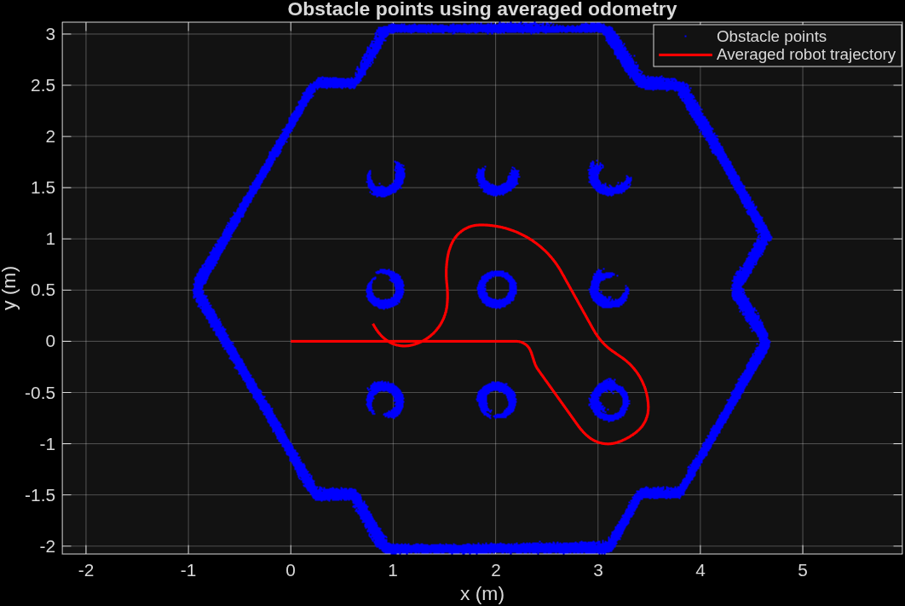
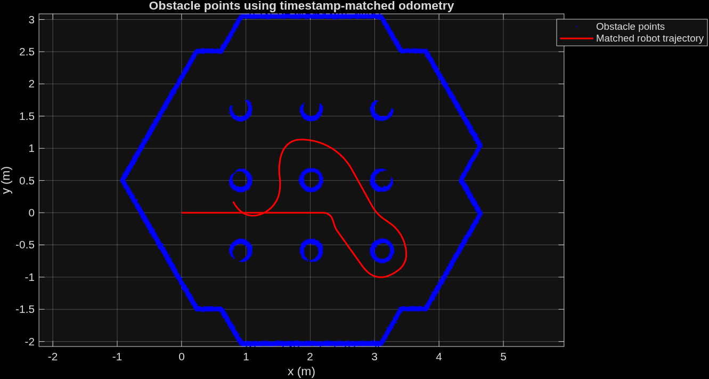

# TurtleBot3 Reverse Teleoperation and LiDAR Mapping

**Reconstructing teleoperation commands from odometry, replaying estimated inputs in ROS 2/Gazebo, and building a 2D LiDAR point map using MATLAB.**

This project analyzes a TurtleBot3 recording where the robot's motion and laser scans were saved, but the original velocity commands were **not**. It estimates likely keyboard teleoperation actions from odometry, replays the reconstructed command sequence in simulation, compares the original and replayed motion, and places LiDAR obstacle detections in a common odometry coordinate frame.

The implementation uses MATLAB, ROS 2 and MCAP rosbag recordings. The provided bag metadata identifies the ROS distribution as **Jazzy**.

> **Scope:** Reconstructed commands are estimates, not ground-truth keyboard events. The LiDAR result is a 2D odometry-referenced obstacle point cloud, not an occupancy grid or a SLAM solution.

## 1. Project objectives

- Analyze the TurtleBot3's recorded position, heading, translational speed and yaw rate.
- Infer likely keyboard actions from changes in quantized velocity levels.
- Reduce false detections using time and magnitude tolerances.
- Replay inferred velocity changes in ROS 2/Gazebo using the simulation clock.
- Compare original and replayed robot trajectories and quantify discrepancies.
- Transform valid LiDAR returns into the odometry frame using the sensor mounting offset and robot pose.
- Compare two scan/odometry association methods: averaged odometry with nearest scans, and exact timestamp matching.

## 2. Repository structure

```text
tb3-reverse-teleop-and-lidar-mapping/
├── assignment1.m                  # Odometry analysis and command inference
├── extra.m                        # ROS 2 command replay and bag recording
├── comparison.m                   # Original-versus-replay trajectory analysis
├── LIDAR.m                        # LiDAR mapping using averaged odometry
├── LIDAR_matched.m                # LiDAR mapping using exact time matches
├── relative_location.m           # Inspection of static sensor transforms
├── estimated_commands.mat         # Saved inferred velocity commands
├── tb3_nocmd/
│   ├── metadata.yaml
│   └── tb3_nocmd_0.mcap            # Original recording, without /cmd_vel
├── tb3_replay_20261112_155831_273/
│   ├── metadata.yaml
│   └── tb3_replay_20261112_155831_273_0.mcap
├── averaged_odom.png
├── matched.png
├── untitled1.png
├── eserc_6.pdf                    # Assignment material
└── .gitattributes
```

The MATLAB scripts use relative paths, so the repository root should be the current MATLAB working directory.

## 3. ROS 2 bag data and topics

The original `tb3_nocmd` bag contains approximately **160 seconds** of data. Its relevant ROS 2 topics are:

| Topic | Message type | Use |
|---|---|---|
| `/odom` | `nav_msgs/msg/Odometry` | Planar pose estimation |
| `/scan` | `sensor_msgs/msg/LaserScan` | 2D range measurements |
| `/tf_static` | `tf2_msgs/msg/TFMessage` | Fixed sensor transforms |
| `/tf` | `tf2_msgs/msg/TFMessage` | Recorded dynamic transforms |
| `/clock` | `rosgraph_msgs/msg/Clock` | Simulation timestamps |

The original bag metadata records **7,862 odometry messages** and **786 scans**, approximately **50 Hz** and **5 Hz**, respectively. Crucially, it contains **no `/cmd_vel` topic**. The included replay bag records `/odom`, `/clock`, and **49 `/cmd_vel` messages** with the type `geometry_msgs/msg/TwistStamped`.

## 4. Processing pipeline

```text
Original rosbag: tb3_nocmd
         |
         +---- /odom --> pose and velocity extraction
         |                     |
         |                     +--> velocity quantization
         |                                 |
         |                                 +--> likely key events
         |                                 +--> estimated_commands.mat
         |                                              |
         |                                              v
         |                                     ROS 2/Gazebo replay
         |                                              |
         |                                              v
         |                                       Replay rosbag
         |                                              |
         |                                              v
         |                                    Trajectory comparison
         |
         +---- /scan + /odom + /tf_static
                               |
                               +--> timestamp association
                               +--> coordinate transformation
                               +--> obstacle-point filtering
                               +--> 2D LiDAR map
```

## 5. Reverse teleoperation from odometry

Implemented in [`assignment1.m`](assignment1.m).

### 5.1 Robot pose and heading

The robot's planar pose is represented by:

```math
\mathbf{q}(t)=
\begin{bmatrix}
x(t) \\
y(t) \\
\theta(t)
\end{bmatrix}
```

The script reads `x` and `y` from `/odom` and converts the recorded quaternion into yaw:

```math
\theta = \mathrm{atan2}\left(2(q_wq_z+q_xq_y),\ 1-2(q_y^2+q_z^2)\right)
```

MATLAB's `unwrap` removes angle discontinuities near the `-pi`/`pi` boundary before differentiation.

### 5.2 Estimating velocities

The original odometry timestamps are used in MATLAB's `gradient` function to estimate the derivatives of position:

```math
\dot{x}\approx\mathrm{gradient}(x,t),\qquad
\dot{y}\approx\mathrm{gradient}(y,t)
```

The estimated planar speed and yaw rate are:

```math
v=\sqrt{\dot{x}^{\,2}+\dot{y}^{\,2}}
```

```math
\omega\approx\mathrm{gradient}(\mathrm{unwrap}(\theta),t)
```

The script also estimates derivatives of speed and yaw rate and plots the robot trajectory, position, heading, speeds and accelerations.

**Important:** `v` is a **nonnegative speed magnitude**; it cannot distinguish forward from reverse motion. Numerical differentiation can also amplify odometry noise.

### 5.3 Classifying robot motion

The script classifies each sample using fixed thresholds:

| Motion label | Condition |
|---|---|
| Stationary | `v <= 0.001 m/s` |
| Straight | Moving and `abs(omega) <= 0.01 rad/s` |
| Left turn | Moving and `omega > 0.01 rad/s` |
| Right turn | Moving and `omega < -0.01 rad/s` |

These labels are displayed as color-coded segments of the XY trajectory.

### 5.4 Inferring teleoperation actions

The script's documented keyboard convention is:

| Key | Action |
|---|---|
| `w` | Increase linear speed by `0.01 m/s` |
| `x` | Decrease linear speed by `0.01 m/s` |
| `a` | Increase angular velocity by `0.1 rad/s` |
| `d` | Decrease angular velocity by `0.1 rad/s` |
| `s` or `Space` | Stop linear and angular motion |

The measured velocity signals are assigned to the nearest assumed command levels:

```math
\hat{v}_k=\Delta v\,\mathrm{round}\left(\frac{v_k}{\Delta v}\right),\qquad
\Delta v=0.01\ \mathrm{m/s}
```

```math
\hat{\omega}_k=\Delta\omega\,\mathrm{round}\left(\frac{\omega_k}{\Delta\omega}\right),\qquad
\Delta\omega=0.1\ \mathrm{rad/s}
```

To suppress brief fluctuations, a new velocity level must remain stable for at least **0.06 s**. The algorithm also searches backward to estimate transition onset using tolerances of **0.0001 m/s** (linear) and **0.01 rad/s** (angular).

Changes in accepted levels are interpreted as possible increase/decrease inputs. When the quantized linear speed changes from nonzero to zero, the code marks a stop and applies the same stop marker to angular motion.

**Interpretation:** These are *inferred* inputs, not recorded keypress events. A larger jump between levels can reflect several rapid inputs, and the code does not uniquely recover each physical press or its timing.

### 5.5 Saved variables

The script saves the inferred command sequence:

```matlab
save('estimated_commands.mat', ...
    't', 'v_quantized', 'w_quantized', 'v_comm', 'w_comm');
```

Here `t` is elapsed time; `v_quantized` and `w_quantized` are the accepted velocity levels; `v_comm` and `w_comm` encode increase (`1`), decrease (`2`), or no change (`0`).

## 6. ROS 2 command replay

Implemented in [`extra.m`](extra.m).

The script loads `estimated_commands.mat`, publishes estimated velocity changes to a TurtleBot3 simulation, and records the resulting experiment into a new MCAP bag.

| Setting | Implementation |
|---|---|
| ROS domain ID | `30` |
| Publisher topic | `/cmd_vel` |
| Publisher message | `geometry_msgs/TwistStamped` |
| Time reference | Gazebo `/clock` |
| Recorded topics | `/odom`, `/cmd_vel`, `/clock` |
| Storage | MCAP |

Replay timing is driven by **simulation time**, not by `pause` commands timed against the computer's wall clock. The code waits for each saved event time, updates whichever velocity component changed, and publishes a stamped message when an inferred change is detected. Unchanged components retain their previous values.

The script attempts to publish a final zero-velocity command and stops its recorder using MATLAB's `onCleanup` mechanism.

> A compatible Gazebo/TurtleBot3 simulation must already be running. The script does not launch the simulator or reset its initial conditions. Its `/cmd_vel` subscriber must accept `geometry_msgs/TwistStamped` and the active ROS domain ID must match `30`.

## 7. Comparing original and replayed trajectories

Implemented in [`comparison.m`](comparison.m).

The program loads the original and supplied replay bags:

```matlab
originalBag = ros2bagreader('tb3_nocmd');
replayBag = ros2bagreader('tb3_replay_20261112_155831_273');
```

It extracts the two trajectories, trims extra replay samples based on where repeated final position readings begin, and checks whether the resulting arrays have identical lengths and elapsed timestamps within **1 microsecond**. If that strict alignment test fails, the script stops before computing pointwise errors.

For aligned samples, the errors are defined as **replay minus original**:

```math
e_x(t)=x_{\mathrm{replay}}(t)-x_{\mathrm{original}}(t)
```

```math
e_y(t)=y_{\mathrm{replay}}(t)-y_{\mathrm{original}}(t)
```

```math
e_\theta(t)=\mathrm{atan2}\left(
\sin(\theta_{\mathrm{replay}}-\theta_{\mathrm{original}}),\
\cos(\theta_{\mathrm{replay}}-\theta_{\mathrm{original}})
\right)
```

The script plots both XY trajectories, position and heading responses, and error time series, including views marked with inferred linear-command changes. It prints minimum, maximum and maximum absolute coordinate/heading errors, plus the final pose difference. The final position discrepancy is:

```math
e_{\mathrm{final}}=\sqrt{e_x(t_f)^2+e_y(t_f)^2}
```

The repository contains the replay dataset, but this README does not claim any specific achieved tracking accuracy: that requires successfully running the comparison and inspecting its numerical outputs.

## 8. LiDAR mapping

Two different scan-to-pose association approaches are implemented:

- [`LIDAR.m`](LIDAR.m): average consecutive odometry measurements, then choose the nearest scan in time.
- [`LIDAR_matched.m`](LIDAR_matched.m): keep only scans whose `(seconds, nanoseconds)` timestamp exactly matches an odometry message.

Both approaches validate ranges, transform laser returns into the odometry frame, filter near-duplicate points, and overlay the accumulated obstacle points with the robot trajectory.

### 8.1 From polar ranges to robot-frame points

For a valid scan measurement with range `r` and angle `alpha`, the planar point relative to the robot base is computed as:

```math
x_b=x_L+r\cos(\alpha+\theta_L)
```

```math
y_b=y_L+r\sin(\alpha+\theta_L)
```

The sensor offset used in both mapping scripts is:

| Sensor parameter | Value |
|---|---|
| `lidar_x` | `-0.032 m` |
| `lidar_y` | `0 m` |
| `lidar_theta` | `0 rad` |

This corresponds to a LiDAR origin **3.2 cm behind `base_link`** in the planar model. Invalid/nonfinite measurements and ranges outside `range_min` and `range_max` are discarded.

### 8.2 Robot-frame to odometry-frame transformation

Using robot pose `(x, y, theta)`, each point is transformed into the fixed odometry frame:

```math
\begin{bmatrix}
x_{\mathrm{odom}} \\
y_{\mathrm{odom}}
\end{bmatrix}
=
\begin{bmatrix}
x \\
y
\end{bmatrix}
+
\begin{bmatrix}
\cos\theta & -\sin\theta \\
\sin\theta & \cos\theta
\end{bmatrix}
\begin{bmatrix}
x_b \\
y_b
\end{bmatrix}
```

### 8.3 Timestamp-association methods

| | `LIDAR.m` | `LIDAR_matched.m` |
|---|---|---|
| Pose source | Mean of 10 consecutive odometry samples | Direct odometry pose |
| Scan source | Nearest scan to each mean odometry time | Only scans with exactly matching timestamps |
| Advantage | Groups odometry measurements | Avoids use of a nonmatching scan time |
| Limitation | Pose and scan may refer to different times | Unmatched scans are discarded |

Neither approach interpolates robot pose to arbitrary scan times or performs scan matching.

### 8.4 Duplicate-point filtering

A transformed point is stored only if it is farther than **0.0002 m (0.2 mm)** from all already stored points. This is a direct distance-based check, not a voxel-grid, occupancy-grid, or probabilistic mapping algorithm.

### 8.5 Mapping visualizations

**Averaged-odometry approach**



**Exactly timestamp-matched approach**



## 9. Static frame calibration

[`relative_location.m`](relative_location.m) reads `/tf_static` to inspect the stored parent/child transforms. In the supplied recording:

| Parent frame | Child frame | Translation | Rotation |
|---|---|---|---|
| `base_footprint` | `base_link` | `z = +0.010 m` | Identity |
| `base_link` | `base_scan` | `x = -0.032 m`, `z = +0.172 m` | Identity |

The 2D LiDAR transformation uses the horizontal offset; the vertical offset does not enter the planar map.

## 10. Installation and execution

### Prerequisites

- MATLAB with **ROS Toolbox**, including support for `ros2bagreader`, `ros2node`, `ros2publisher`, and `ros2bagrecorder`.
- The repository's MCAP recordings for offline analyses.
- For replay only: a running TurtleBot3-compatible ROS 2/Gazebo simulation that provides `/clock`, `/odom`, and a compatible `/cmd_vel` interface.

The repository includes analysis scripts and datasets but **no Gazebo launch files**.

### Step 1 — Clone the repository

```bash
git clone https://github.com/ahmednabildo/tb3-reverse-teleop-and-lidar-mapping.git
cd tb3-reverse-teleop-and-lidar-mapping
```

Set MATLAB's current folder to this directory.

### Step 2 — Analyze odometry and estimate commands

```matlab
run('assignment1.m')
```

This displays trajectory, velocity, acceleration and inferred-command plots, then writes `estimated_commands.mat`.

### Step 3 — Build both LiDAR maps

```matlab
run('relative_location.m')  % Optional: inspect static transforms
run('LIDAR.m')               % Averaged odometry + nearest scans
run('LIDAR_matched.m')       % Exact timestamp matching
```

Each MATLAB script is independent. Mapping does not require the robot to be running live.

### Step 4 — Replay the estimated commands

Start the compatible simulation first. Configure ROS discovery to use domain ID **30** and verify the published topics from an appropriately configured terminal:

```bash
ros2 topic list
ros2 topic info /cmd_vel
ros2 topic echo /clock
```

Then run:

```matlab
run('extra.m')
```

This creates a new `tb3_replay_<timestamp>` folder with an MCAP recording. The repository already contains a previous recording in `tb3_replay_20261112_155831_273/`.

### Step 5 — Compare the trajectories

```matlab
run('comparison.m')
```

By default, the script loads the **included** replay folder named above. To compare a newly recorded run, change the replay bag path in `comparison.m`. Its strict sample alignment assertions may require adapting the preprocessing for a different run.

## 11. Key analysis parameters

| Parameter | Script | Value | Purpose |
|---|---|---|---|
| `v_tol` | `assignment1.m` | `0.001 m/s` | Stationary threshold |
| `w_tol` | `assignment1.m` | `0.01 rad/s` | Turning threshold |
| `v_step` | `assignment1.m` | `0.01 m/s` | Linear command level increment |
| `w_step` | `assignment1.m` | `0.1 rad/s` | Angular command level increment |
| `level_hold_time` | `assignment1.m` | `0.06 s` | Minimum candidate-level persistence |
| `v_onset_tol` | `assignment1.m` | `0.0001 m/s` | Linear transition onset tolerance |
| `w_onset_tol` | `assignment1.m` | `0.01 rad/s` | Angular transition onset tolerance |
| `samples_per_average` | `LIDAR.m` | `10` | Odometry readings per averaged pose |
| `obstacle_tol` | Both LiDAR scripts | `0.0002 m` | Spatial duplicate filter |
| `domainID` | `extra.m` | `30` | Replay ROS domain |

## 12. Limitations and future work

**Limitations:** Input recovery is ambiguous without the original command stream; speed magnitude discards forward/reverse sign; numerical derivatives are noise-sensitive; velocity-level estimation assumes fixed teleoperation increments; replay depends on simulation initialization and topic compatibility; trajectory comparison requires stringent time alignment; and the LiDAR map is odometry-based without SLAM or an occupancy representation.

**Possible extensions:** Estimate signed linear velocity, introduce filtering and confidence scores for inferred commands, distinguish closely spaced keypresses using dynamic response models, optimize replay timing, interpolate odometry to scan timestamps, add automated trajectory error metrics, accelerate point deduplication using a spatial index, and build an occupancy grid or SLAM-based mapping stage.

## 13. Project context

The project explores **inverse teleoperation, ROS 2 data analysis and replay, trajectory validation, coordinate transformations, and LiDAR-based environment reconstruction** using TurtleBot3. The original exercise document is included as [`eserc_6.pdf`](eserc_6.pdf).

## Author

**Ahmed Nabil Donia**  
MSc Mechanical Engineering — Mechatronics Track  
Politecnico di Milano

[GitHub profile](https://github.com/ahmednabildo)
